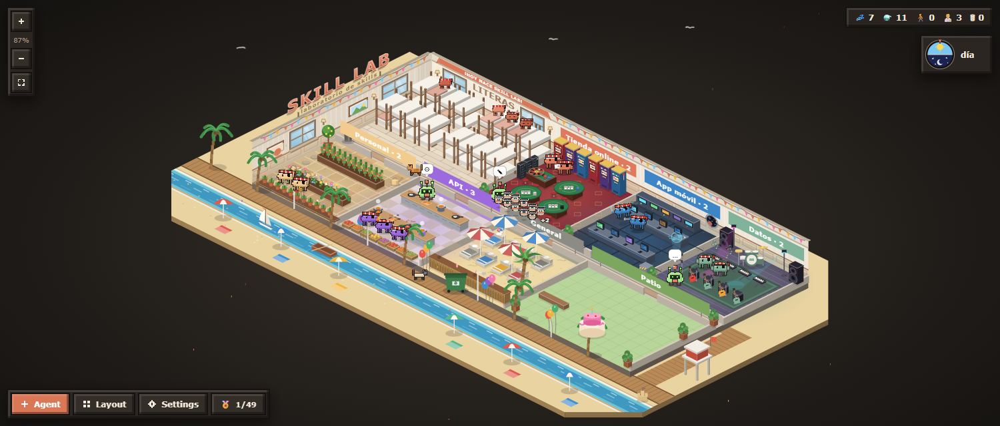
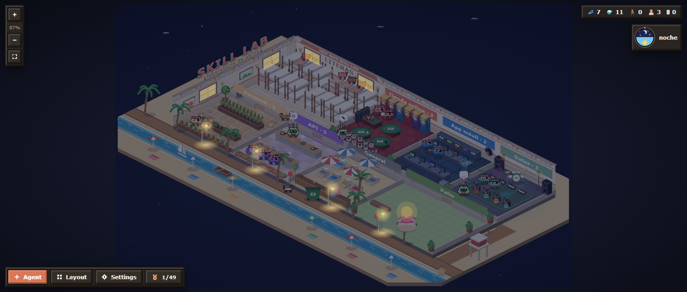
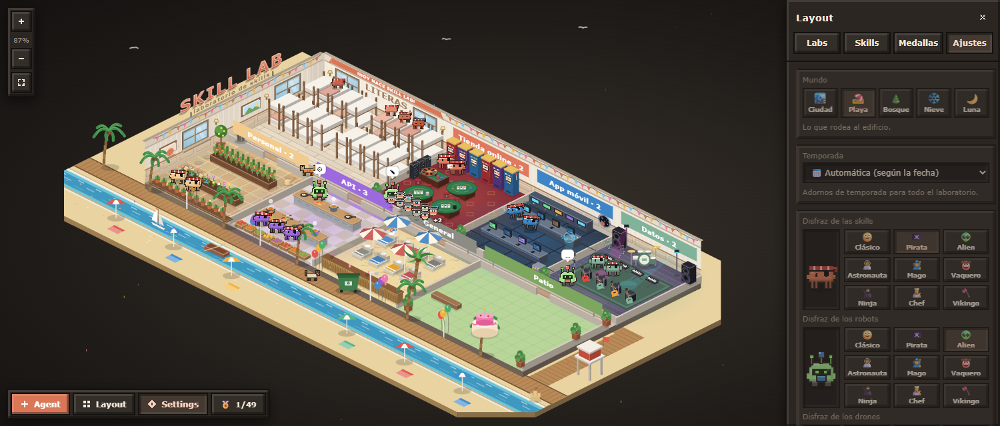
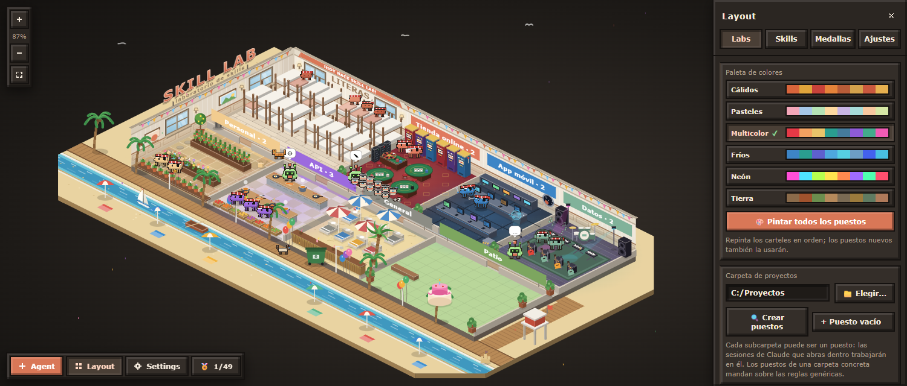

# Skill Lab

**Un laboratorio isométrico en el panel de VS Code donde ves trabajar a Claude Code.** Cada skill es un muñeco que duerme en su litera y, cuando Claude la usa, va andando al puesto del proyecto en el que estás trabajando. Las sesiones de Claude son robots que te cuentan qué están haciendo, y sus subagentes, drones que revolotean a su alrededor.



## Qué hace

- **Una skill, un muñeco.** Cuando una sesión usa una skill, el muñeco sale de las literas, va al puesto de ese proyecto y toma su color; al terminar el turno vuelve a dormir.
- **Un puesto por proyecto, con 13 temas.** Laboratorio, gimnasio, cafetería, biblioteca, arcade, cuartel, zona de fumadores, invernadero, estudio de música, estación espacial, cocina, chiringuito y casino. Cada uno con su mobiliario y su forma de trabajar: regar, tocar la batería, flotar en gravedad cero, cocinar, tomar el sol o apostar.
- **Sesiones y subagentes en directo.** Cada sesión de Claude Code es un robot con un bocadillo (pensando, escribiendo, leyendo, ejecutando, esperando…). Los subagentes, también los lanzados en segundo plano, salen como drones junto a su robot.
- **Servidores con piloto.** Cada puesto puede mostrar los servicios desplegados de su proyecto como armarios: luz verde si responden, roja si se han caído. Al pasar el ratón sale su nombre.
- **Cinco mundos.** El edificio puede estar en la ciudad, en la playa, en el bosque, en la nieve o en la Luna.
- **Temporadas.** Halloween, Navidad, Nochevieja, Reyes, Carnaval, San Valentín, San Fermín, las cuatro estaciones… se ponen solas según la fecha, o eliges una.
- **Disfraces y colores.** Pirata, alien, astronauta, mago, vaquero, ninja, chef o vikingo, por separado para los muñecos, los robots y los drones. Seis paletas para los carteles: cálidos, pasteles, multicolor, fríos, neón y tierra.
- **Día y noche, avisos y gatos.** La luz sigue la hora real, suena un aviso cuando Claude termina o espera permiso, y los gatos reaccionan a cada sala en la que los sueltes.
- **62 medallas** escondidas para quien las encuentre. Pistas: en el casino hay tragaperras de verdad, Wally sale a pasear algunas horas, en Navidad Papá Noel cruza el cielo de noche y quien lo consigue todo encuentra algo rojo al final del camino de la puerta lateral, y cuando lo tienes todo, el laboratorio se convierte en un juego incremental con historia: ayudantes, árbol de mejoras, artefactos, cofres, botones dorados y tres combates contra el Doctor Zarpas.



## Instalación

1. Descarga `skill-lab-1.5.0.vsix` de la última [release](https://github.com/AlvaroMDX/skill-lab/releases/latest).
2. En VS Code: **Extensiones → ··· → Install from VSIX…** y elige el fichero.
   También desde un terminal: `code --install-extension skill-lab-1.5.0.vsix`.
3. Recarga la ventana (**Developer: Reload Window**).

Para compilarla desde el código:

```bash
npm install
npx esbuild@0.24.0 src/extension.ts --bundle --platform=node --format=cjs --external:vscode --outfile=dist/extension.js
npx esbuild@0.24.0 media/src/arena3d.js --bundle --format=iife --minify --outfile=media/arena3d.js
npx @vscode/vsce@3.2.1 package
```

## Cómo se usa

1. Abre la pestaña **Skill Lab** del panel inferior.
2. La primera vez, un asistente te pide la carpeta donde guardas tus proyectos y crea un puesto por cada subcarpeta que marques.
3. Trabaja con Claude Code como siempre: el laboratorio se mueve solo.
4. Usa estos controles:
   - **Rueda** o **+ / −**: zoom. **Arrastrar el fondo**: desplazar el mapa.
   - **Clic en un muñeco**: ver su nombre. **Doble clic**: abrir su ficha.
   - **+ Agent**: lanzar una sesión nueva de Claude Code en una carpeta.
   - **Layout**: puestos (tema, fila, ancho, carpeta y servicios), paleta de colores, skills fijas, medallas y ajustes.



## Configuración

Casi todo se ajusta desde el propio panel:

- **Layout → Labs**: paleta de colores para todos los puestos y, en cada puesto, su tema, fila, ancho, carpeta y **Servicios** (una línea por servicio, `Nombre = https://url`). Los servicios se comprueban cada minuto; cuentan como caídos si no responden en 8 s o devuelven un error 5xx.
- **Layout → Skills**: cada skill puede ir siempre al mismo puesto o seguir al repositorio de la sesión que la usa.
- **Layout → Ajustes**: mundo, temporada, disfraces, día y noche, sonidos y gatos.

En los ajustes de VS Code (`skillLab.*`) quedan además el ejecutable de Claude Code para **+ Agent** y la opción de lanzarlo sin pedir permisos. La distribución de puestos se guarda en `~/.claude/skill-lab/config.json`.



## Requisitos

- VS Code 1.90 o posterior.
- Claude Code (CLI o extensión de VS Code) usándose en la misma máquina.

## Privacidad

Skill Lab lee las transcripciones locales de Claude Code (`~/.claude/projects`) para saber qué skills se usan y qué hace cada sesión, y lo procesa todo en tu equipo. Solo hace peticiones de red a las direcciones que tú pongas como servicios de un puesto, para saber si responden.

## Comandos

| Comando | Qué hace |
| --- | --- |
| `Skill Lab: Redibujar` | Vuelve a pintar el laboratorio. |
| `Skill Lab: Lanzar Claude Code (+ Agent)` | Abre una sesión nueva en la carpeta que elijas. |
| `Skill Lab: Editar layout (labs y skills)` | Abre el cajón para organizar puestos y skills. |

---

Autor: **Alvaro Martos Diez** · Las capturas usan puestos, skills y servicios de ejemplo.
